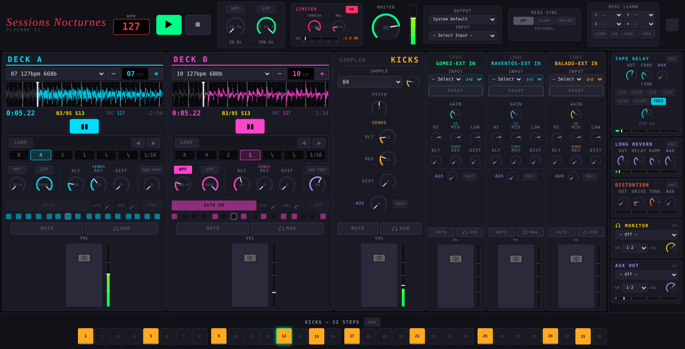
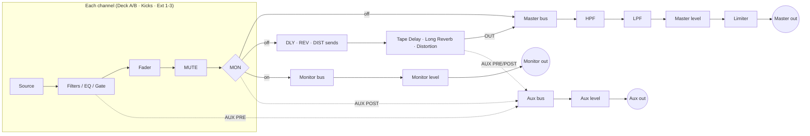

# Sessions Nocturnes — PLYGRND V2

A browser-based live / DJ performance mixer built for the **Sessions Nocturnes** project.
Two beat-synced track decks, a 32-step kick sampler, three live inputs, three send effects,
an output limiter, separate **Monitor** and **Aux** outputs, MIDI clock sync and MIDI learn
for up to **four controllers at once**, all running in a single web page.



- **No build step, no dependencies.** It is plain HTML, CSS and JavaScript using the Web Audio API and the Web MIDI API.
- **Made for live use.** Every sample is preloaded at startup, the scheduling never stalls when you load a track mid-set, and every control can be mapped to hardware.

---

## Contents

1. [At a glance](#at-a-glance)
2. [Quick start](#quick-start)
3. [Signal flow](#signal-flow)
4. [Header](#header)
5. [Track decks A & B](#track-decks-a--b)
6. [Kick sampler & 32-step sequencer](#kick-sampler--32-step-sequencer)
7. [External inputs](#external-inputs)
8. [Channel sends: FX & AUX](#channel-sends-fx--aux)
9. [Effects](#effects)
10. [Master section & limiter](#master-section--limiter)
11. [Monitor output (headphones)](#monitor-output-headphones)
12. [Aux output](#aux-output)
13. [Metering](#metering)
14. [MIDI sync](#midi-sync)
15. [MIDI learn](#midi-learn)
16. [Keyboard & mouse](#keyboard--mouse)
17. [Performance panel](#performance-panel)
18. [Persistence](#persistence)
19. [Browser support & limitations](#browser-support--limitations)
20. [Project structure](#project-structure)

---

## At a glance

| | |
|---|---|
| **Track decks** | 2 (A / B): 29-track library, auto beat-sync to master BPM, loops, filters, 16-step gate |
| **Kick sampler** | 1: 20 samples + OFF, ±12 semitone pitch, 32-step sequencer |
| **External inputs** | 3 (GOMEZ · RAVENTÓS · BALADO): any audio input device, stereo or single input |
| **Send effects** | 3: Tape Delay · Long Reverb · Distortion |
| **Sends per channel** | DLY · REV · DIST (post-fader) + stereo **AUX** (PRE / POST) |
| **Channel controls** | MUTE · MON (monitor) · fader · post-fader level meter |
| **Master** | HPF (20–700 Hz) · LPF (200 Hz–20 kHz) · brickwall limiter · master level · peak meter |
| **Outputs** | **Master**, **Monitor** and **Aux**: 3 stereo outputs, each on any device and any channel pair |
| **Tempo** | 60–200 BPM · internal, MIDI clock **slave** or MIDI clock **master** (24 PPQN) |
| **MIDI learn** | 4 independent controller slots · CC and notes · knobs, faders and buttons · save/load JSON |
| **Metering** | master peak · 6 channel meters · 3 FX meters · aux meter · limiter gain reduction |

---

## Quick start

1. **Put the samples next to `index.html`:**

   ```
   samples/
   ├── tracks/          01.mp3 … 29.mp3     (deck library)
   └── kicks-samples/   01.mp3 … 20.mp3     (kick sampler)
   ```

2. **Serve the folder over HTTPS or from `localhost`.** Microphone, MIDI and output-device selection only work in a secure context.

   ```bash
   # any static server works, e.g.
   python3 -m http.server 8000
   # → http://localhost:8000
   ```

3. **Open it in Chrome or Edge** (recommended; see [browser support](#browser-support--limitations)).
   - Allow **MIDI** access when asked.
   - Allow the **microphone** when you first open an input list or press READY.

4. **Wait for the preloader.**
   - Every sample is fetched and decoded once, and the deck waveforms are pre-computed.
   - **SKIP** starts immediately and loads samples on demand.

5. **Press PLAY (or Space).** Load tracks into the decks and start mixing.

---

## Signal flow



Key points:

- **FX sends are post-fader.** They are tapped after the gate, the fader, MUTE and MON. If you pull the fader down, mute the channel or put it in MON, nothing new reaches the effects (tails ring out naturally).
- **The FX returns go through the master HPF/LPF, the master level and the limiter**, so the master filters sweep the effects too.
- **MON** takes a channel *out of the master* (FX sends included) and sends it to the Monitor output only.

---

## Header

From left to right:

| Module | What it does |
|---|---|
| **BPM** | Master tempo, 60–200 BPM. Type a value or use the mouse wheel (±0.5). Locked while in MIDI SLAVE mode. |
| **PLAY / STOP** | Global transport. STOP also stops both decks and resets gates. |
| **Master filters** | **HPF** 20–700 Hz and **LPF** 200 Hz–20 kHz, each with an on/off toggle. Turning one off opens it fully and remembers its frequency. |
| **Limiter** | Output brickwall limiter. See [Master section & limiter](#master-section--limiter). |
| **Master** | Master level knob (0–100). |
| **Meter** | Vertical output peak meter, measured *after* the limiter. |
| **Output / Input** | Master output device; the input list mirrors EXT 1 (GOMEZ). |
| **MIDI Sync** | INT / SLAVE / MASTER clock mode. See [MIDI sync](#midi-sync). |
| **MIDI Learn** | 4 controller slots plus LEARN · CLR · SAVE · LOAD. See [MIDI learn](#midi-learn). |
| **⚡** | Performance panel. |

---

## Track decks A & B

Each deck plays one track from the 29-track library and keeps it **locked to the master BPM**.

### Library & loading

- **Track list**: shows `number · original BPM · length in bars`.
- **− / display / +**: browse the library without the mouse. All three can be MIDI-mapped.
  - **Deck stopped:** the browsed track loads by itself ~350 ms after the last press.
  - **Deck playing:** − / + only browse and the display blinks. **Press the display to load**, so a playing track is never cut by accident.
- Loading is instant: tracks and waveforms are cached by the preloader.

### Sync

- Every track has a known bar count and original BPM (the `TRACK_DB` table in `js/track-player.js`). The deck computes the playback rate so **one bar of the track = one bar at the master BPM**.
- It re-syncs at every bar boundary if drift exceeds half a 16th note.
- **PLAY while the transport runs** waits for the next bar (the button blinks), so decks always start on the grid.

### Waveform

- A scrolling overview with bar and beat lines, bar numbers, playhead and loop region. It is drawn in HiDPI and fills the available height.
- **Click** on a bar:
  - *stopped*: sets the start point to that bar.
  - *playing*: jumps to that bar at the next bar boundary (shown in yellow).
- **Drag** to scroll the view. It snaps back after 3 s.

### Info row

Elapsed time · current bar/step (`B12/668 S5`) · source BPM · remaining time.

### Loop

| Control | Range / behaviour |
|---|---|
| **LOOP** | Engage / release. Engaging is quantized: it waits for the next bar (or the next ¼ / ⅛ / 1/16 for short loops). While waiting it shows `PEND`. |
| **Size** | 8 · 4 · 2 · 1 · ¼ · ⅛ · 1/16 bars. You can change it while looping. |
| **◀ / ▶** | Shift the loop by its own length (snapped to 16ths). |

Releasing a loop continues from the current position; the next bar re-syncs automatically.

### Filters

| Control | Range |
|---|---|
| **HPF** | 20–700 Hz, with on/off |
| **LPF** | 200 Hz–20 kHz, with on/off |

### Gate (16 steps)

A rhythmic volume gate driven by the transport. It runs at **1/8 notes**: 16 steps = one 2-bar cycle.

| Control | Range / behaviour |
|---|---|
| **GATE** | On / off. Off fully opens the gate. |
| **Steps** | Click to toggle each step open/closed. The current step is highlighted. |
| **RND** | Random pattern (40–80 % density, step 1 always open). Also switches the gate on. |
| **ATK** | Opening time, 1–250 ms (default 6 ms = hard gate). |
| **REL** | Closing time, 1–500 ms (default 6 ms). Long REL values turn the gate into a "breathing" effect. |

### Channel strip

Sends (DLY · REV · DIST · AUX), **MUTE**, **MON** (🎧), fader with post-fader meter.
See [Channel sends](#channel-sends-fx--aux) and [Monitor output](#monitor-output-headphones).

---

## Kick sampler & 32-step sequencer

| Control | Range / behaviour |
|---|---|
| **Sample** | Menu, or the **kick knob** next to it: **OFF**, then samples 01–20. The knob changes the sample instantly, is MIDI-learnable and stays in sync with the menu. OFF silences the kick even if steps are active. |
| **Pitch** | −12 … +12 semitones (integer steps) |
| **Sends** | DLY · REV · DIST · AUX (PRE/POST) |
| **MUTE / MON / fader / meter** | As on every channel |

**Sequencer (footer)**

- 32 steps of 16th notes = 2 bars, with beats and bars marked.
- Click a step to toggle it.
- **RND** keeps the 8 downbeats and adds 0–8 random extra hits.

---

## External inputs

Three identical live channels: **CH05 GOMEZ**, **CH06 RAVENTÓS** and **CH07 BALADO**.

| Control | Range / behaviour |
|---|---|
| **INPUT** | Any audio input device Chrome can see. The list updates when devices are plugged in or out. |
| **IN** | **1+2** (stereo) or any single input of the device (IN 1, IN 2 …). A single input is played centred. Several channels can use different inputs of the same interface; the device is opened only once. |
| **READY / LIVE** | Arms the channel. Monitoring is closed until you press READY. |
| **Status line** | Shows the channel count and the input in use, or the exact error if the device can't be opened (permission denied, device busy, not found…). |
| **GAIN** | 0–3× (up to about +9.5 dB) |
| **EQ** | 3-band peaking EQ (Q 1): **LOW** 280 Hz · **MID** 1 kHz · **HI** 4.5 kHz, each −24 to +6 dB |
| **Sends** | DLY · REV · DIST · AUX (PRE/POST) |
| **MUTE / MON / fader / meter** | As on every channel |

Input processing (echo cancellation, noise suppression, auto gain) is **disabled**, so you get the raw signal.

---

## Channel sends: FX & AUX

Every channel (Deck A, Deck B, Kicks, Ext 1-3) has:

| Send | Range | Tap point |
|---|---|---|
| **DLY** → Tape Delay | 0–100 | Post-fader (after gate, fader, MUTE, MON) |
| **REV** → Long Reverb | 0–100 | Post-fader |
| **DIST** → Distortion | 0–100 | Post-fader |
| **AUX** → Aux bus (stereo) | 0–100 | **POST** (default) or **PRE**, selectable per channel |

**AUX POST vs PRE**

| | POST (default) | PRE |
|---|---|---|
| Tap point | After fader, MUTE and MON: exactly what goes to the master | Before the fader (after filters / EQ / gate) |
| Follows the fader | yes | no |
| Cut by MUTE | yes | yes |
| Cut by MON | yes | no |

---

## Effects

All three are send effects with a 100 % wet signal and an **OUT** level that returns to the master (through the master filters and limiter). Each one also has its own **AUX** send (PRE = full wet level, POST = after OUT, default) and an output meter.

| Effect | Controls |
|---|---|
| **Tape Delay** | **OUT**, **FDBK** 0–95 %, **TIME** 10–500 ms (FREE) or tempo-synced 1/4 · 1/4T · 1/8 · 1/8T · 1/16 · 1/16T (follows BPM changes). Tape-style low-pass (3.5 kHz) in the feedback path. |
| **Long Reverb** | **OUT**, **DECAY** 1–10 s, **DAMP** 500 Hz–12 kHz. 8-line feedback delay network with 25 ms pre-delay and diffusion. |
| **Distortion** | **OUT**, **DRIVE** 1–50, **TONE** 500 Hz–8 kHz (low-pass). Soft-clip waveshaper with 4× oversampling. |

---

## Master section & limiter

**Master chain:**

```
master bus → HPF → LPF → master level → limiter → master output
```

**Limiter**

- Look-ahead **brickwall** peak limiter (AudioWorklet, 5 ms look-ahead, stereo-linked). The output never exceeds the threshold.
- Falls back to a fast compressor if the browser has no AudioWorklet support.

| Control | Range |
|---|---|
| **THRESH** | −24 to −0.1 dBFS (default −1.0): the output ceiling, so the master never hits 0 dBFS |
| **REL** | 10–1000 ms (default 150 ms) |
| **ON / OFF** | Bypass |
| **GR meter** | Gain reduction 0 to −12 dB, with peak hold and a numeric read-out |

---

## Monitor output (headphones)

Pre-listen any channel without the audience hearing it.

- **🎧 MON** on a channel takes it **out of the master and its FX sends** and plays it **only** on the Monitor output.
  - Switch MON off and the channel goes back to the master at exactly the same level (MON is post-fader).
- **MONITOR module** (right panel):

| Control | |
|---|---|
| **Output** | Any output device Chrome sees: your interface, BlackHole, the Mac headphone jack… |
| **CH** | Channel pair of that device: 1-2, 3-4 … 7-8 (only the pairs the device exposes) |
| **LVL** | Monitor level 0–150 |
| **Status** | Which channels are in MON and where they go. Warns in red if MON is on with no output selected. |

Routing notes:

- **Same device as the master** (e.g. master on 1-2, monitor on 7-8): one audio clock, so there is no drift between the outputs.
- **A different device**: a second audio stream is used. It works anywhere, with slightly more latency than the master.

---

## Aux output

A third stereo output, fed by the AUX sends of all channels and effects.

| Control | |
|---|---|
| **Output / CH** | Any device and channel pair, same as Monitor |
| **LVL** | Aux level 0–150 |
| **Meter** | What reaches the aux output |

Monitor and Aux can share an interface on different channel pairs (e.g. Monitor 7-8, Aux 5-6).

---

## Metering

All meters use the same peak scale: green → red, peak hold, marks at −12 / −6 / −3 dBFS, and a red frame on clipping.

| Meter | Position | Measures |
|---|---|---|
| **Master** | Header, vertical | Final output, after the limiter |
| **Channel** ×6 | Next to each fader, vertical | Post-fader, post-mute level |
| **FX** ×3 | Under each effect, horizontal | Effect output (after OUT) |
| **Aux** | Aux module, horizontal | Aux bus after LVL |
| **Limiter GR** | Limiter module | Gain reduction in dB |

---

## MIDI sync

| Mode | Behaviour |
|---|---|
| **INT** | Internal clock, BPM set in the header. |
| **SLAVE** | Choose a MIDI input. The tempo follows incoming **MIDI clock (24 PPQN)**, smoothed and updated every beat. **Start / Continue / Stop** messages start and stop the transport. |
| **MASTER** | Choose a MIDI output. Sends **MIDI clock (24 PPQN)** at the current BPM, plus **Start / Stop** with the transport. |

The status line shows `LISTENING`, `SYNCED ▶`, `MASTER ▶`, etc., and the detected or sent BPM.

---

## MIDI learn

Map any knob, fader or button to hardware, on up to **4 controllers at the same time**.

### Controller slots

- The MIDI LEARN module has **4 slots (1-4)**. Pick one MIDI device per slot.
- **Each slot keeps its own mappings**, so two controllers sending the same CC never collide.
- Slots remember their device **by name** and reconnect automatically when the controller is plugged back in.
- Badges show the mapping on each control: `CC20` for slot 1, `2·CC20` / `3·CC20` / `4·CC20` (coloured) for the other slots.

### How to map

1. Press **LEARN**. Controls highlight on hover.
2. **Right-click** the on-screen control you want to map.
3. Move a knob or fader, or press a button or pad, on **any** of your controllers.
4. Done. Repeat for more controls. **Esc** or a click on the overlay cancels, and **LEARN** again exits learn mode.

### Mapping behaviour

| Target | How it responds |
|---|---|
| **Knobs / faders** | CC 0–127 is scaled to the control's full range. Integer controls snap, e.g. the kick knob: OFF … 20. |
| **Buttons** | Trigger on the rising edge (value crossing 64), so both momentary pads and toggle buttons work. |
| **Notes** | Work too: note on = press, note off = release. |

- Each on-screen control has one mapping. Re-learning replaces it.

### Managing mappings

| Button | Action |
|---|---|
| **CLR** | Remove all mappings |
| **SAVE** | Download a `.json` file with all mappings **and** the controller assigned to each slot |
| **LOAD** | Load a mapping file (V1 files load into slot 1) |

Mappings are also stored in the browser and restored automatically on every start.

### What can be mapped

Practically everything:

- **Transport:** play / stop.
- **Master section:** HPF / LPF toggles and knobs, master level, limiter THRESH / REL / ON.
- **Every channel:** fader, all knobs, MUTE, MON, AUX PRE/POST.
- **Decks:** play, loop on/off, loop sizes, loop shift, HPF / LPF, gate on/off, ATK / REL, track − / LOAD / +.
- **Kick:** sample knob, pitch, sends.
- **Ext inputs:** READY, gain, EQ, sends.
- **Effects:** every knob, the delay sync buttons, FX AUX knob and PRE/POST.
- **Outputs:** Monitor LVL and Aux LVL.

---

## Keyboard & mouse

| Action | |
|---|---|
| **Space** | Play / stop |
| **Esc** | Cancel MIDI learn |
| **Drag a knob** up/down | Change value |
| **Double-click a knob** | Reset to default |
| **Drag a fader** vertically | Change level (works the same on macOS and Windows) |
| **Mouse wheel on a fader** | Fine adjust |
| **Mouse wheel on BPM** | ±0.5 BPM |
| **Right-click** (in LEARN mode) | Pick the control to map |

---

## Performance panel

The **⚡** button opens a panel with:

- an estimated main-thread load;
- base and output latency;
- the sample rate;
- the audio context state;
- a glitch counter.

The **Buffer / Latency mode** setting (Interactive · Balanced · Playback) rebuilds the audio engine. **Reload the page after changing it.**

---

## Persistence

Stored locally in the browser:

- MIDI mappings and the controller in each learn slot
- The input device and IN selection of each external channel
- Monitor and Aux output devices and channel pairs

Nothing is sent to any server.

---

## Browser support & limitations

- **Chrome / Edge (desktop)** are recommended. They support everything used here: Web MIDI, AudioWorklet and output-device selection (`AudioContext.setSinkId`, Chrome 110+).
- **Firefox and Safari** may lack MIDI and/or output-device selection.
- **Secure context required:** serve over HTTPS or `localhost`.
- **Multichannel interfaces:**
  - Chrome usually delivers only the **first 2 input channels** of an interface. The IN selector shows what the browser actually provides.
  - The output channel pairs (e.g. 7-8) also depend on what the device exposes to Chrome.
- **Memory:** decoded audio takes about **23 MB per minute** (stereo, 48 kHz, 32-bit float). Preloading the full library keeps every track in RAM; plan for this on long libraries.
- **Adding tracks:** add the files to `samples/tracks/` and an entry `{ bars, bpm }` per track to `TRACK_DB` in `js/track-player.js` (and update the track count in `_populateSelector`).

---

## Project structure

```
index.html              UI layout
ahc.ico                 favicon
css/
  mixer.css             base theme & layout
  channel-base.css      shared channel strip styles
  ch08-tracks.css       decks
  ch05-kicks.css        kick sampler
  ch06-input.css        external inputs
  ch06-delay.css        FX panel colours
  midi-clock.css        MIDI sync / learn
  perf-monitor.css      performance panel
  sample-preloader.css  boot preloader
  v2.css                V2 layout & new modules
js/
  app.js                boot & global wiring
  audio-engine.js       AudioContext, master graph, input devices
  limiter.js            limiter UI & node
  limiter-processor.js  limiter AudioWorklet (look-ahead brickwall)
  cue.js                output router · Monitor (MON) · Aux sends
  transport.js          look-ahead step scheduler (16ths)
  track-player.js       decks: sync, loop, gate, waveform, browse
  sequencer.js          kick sampler & 32-step sequencer
  ext-input.js          3 external input channels
  tape-delay.js         tape delay
  reverb.js             FDN reverb
  distortion.js         distortion
  global-filters.js     master HPF / LPF
  midi-clock.js         MIDI clock sync + 4 learn inputs
  midi-learn.js         MIDI learn mapping, save/load
  level-meters.js       channel / FX / aux meters
  vu-meter.js           master meter
  knob.js               SVG knob component
  ui-helpers.js         output selector, vertical faders
  sample-preloader.js   boot-time sample & waveform cache
  perf-monitor.js       performance panel
  utils.js              helpers
samples/                (not included) tracks & kick samples
```

---

*Sessions Nocturnes — PLYGRND V2*
